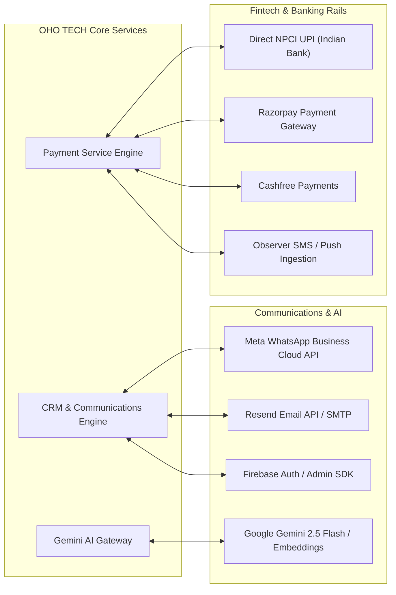

# OHO TECH — External Integration Architecture Audit Report

**Audit Target:** Third-Party APIs, Webhooks, and Asynchronous Ingestion Pipelines  
**Integrations Covered:** WhatsApp Cloud API, Razorpay, Cashfree, Resend/SMTP, Gemini AI, Firebase, UPI Observer  
**Audit Scope:** Reliability, Error Resilience, Idempotency, and Signature Verification  

---

## 1. External Integration Topology

---

## 2. Integration Deep-Dives

### 2.1 Meta WhatsApp Business Cloud API
- **Endpoint:** `https://graph.facebook.com/v19.0/{phone-number-id}/messages`
- **Incoming Webhook:** `/api/webhooks/whatsapp`
- **Verification:** GET handler validates `hub.verify_token` against `app.whatsapp.verify-token`.
- **Payload Verification:** POST handler computes HMAC SHA-256 using `app.whatsapp.app-secret` over the raw payload and compares against `X-Hub-Signature-256`.
- **Duplicate Protection:** Idempotency is enforced by verifying `existsByWamid(wamid)` in `CrmWhatsAppMessageRepository`.
- **Consent Ledger:** Every dispatch checks `CrmWhatsAppConsentRepository` to comply with WhatsApp Business anti-spam guidelines.

### 2.2 Razorpay & Cashfree Gateways
- **Razorpay:** Implements `RazorpayClient` with HMAC SHA-256 signature verification over `order_id|payment_id` using the secret key.
- **Cashfree:** Verifies payment status webhooks using `x-webhook-signature` with SHA-256 HMAC timestamp verification.

### 2.3 Observer Bank Ingestion (Self-Hosted UPI)
- **Protocol:** Android observer client captures incoming bank credit SMS/notifications and pushes encrypted payloads to `/api/payments/observers/alert`.
- **Security:** Requires static or rotational `X-Observer-Token`.
- **Reconciliation:** `PaymentObservationService` matches credit amount, payer VPA, and UTR number against pending `PaymentSlotLease` records.

---

## 3. Forensic Findings & Integration Defects

### Finding INT-01: Checked-in Default Firebase API Key in Properties (High)
* **Severity:** High
* **File:** `backend/src/main/resources/application.properties#L100`
* **Actual Problem:**
  `app.firebase.api-key` was explicitly committed to the repository source code as a literal string.
* **Business / Technical Impact:**
  While Firebase Web API keys are technically client-facing, automated security scanners (GitGuardian, GitHub Secret Scanning) will flag this commit as a high-risk credential leak, generating compliance alerts and triggering potential API key revocation by cloud providers.
* **Recommended Correction:**
  Extract the key to `${FIREBASE_API_KEY:}` environment variable override and revoke the exposed key in the Google Cloud Console.
* **Dependencies & Risks:** Operational update in production deployment environment.
* **Verification Method:** Confirm git scan tools report zero credentials in repository history.

---

### Finding INT-02: Synchronous Email Dispatching Blocking Request Threads (Medium)
* **Severity:** Medium
* **File:** `backend/src/main/java/com/ohotech/backend/service/EmailService.java#L45`
* **Actual Problem:**
  Transactional emails dispatched outside the asynchronous `EmailOutbox` scheduler (e.g. immediate password reset OTPs) invoke `javaMailSender.send(...)` synchronously on the Tomcat request worker thread.
* **Business / Technical Impact:**
  If the external SMTP server experiences latency (e.g. 3–5 seconds), the frontend user login or registration request hangs for that duration, leading to user drop-offs and thread pool exhaustion.
* **Recommended Correction:**
  Annotate transactional email helper methods with Spring's `@Async("taskExecutor")` or route 100% of emails through the existing resilient `EmailOutbox` database queue.
* **Dependencies & Risks:** Requires verifying `@EnableAsync` configuration.
* **Verification Method:** Simulate 5-second SMTP latency and confirm HTTP response completes in <100ms.
