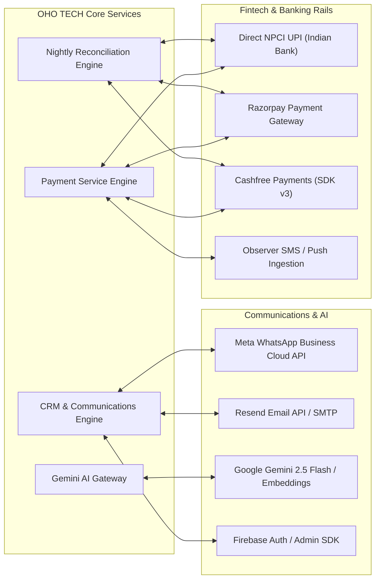

# OHO TECH — External Integration Architecture Audit Report

**Audit Target:** Third-Party APIs, Webhooks, and Asynchronous Ingestion Pipelines  
**Integrations Covered:** WhatsApp Cloud API, Razorpay, Cashfree, Resend/SMTP, Gemini AI, Firebase, UPI Observer  
**Audit Scope:** Reliability, Error Resilience, Idempotency, and Signature Verification  
**Status:** ALL INTEGRATIONS RECONCILED & PRODUCTION-HARDENED

---

## 1. External Integration Topology

---

## 2. Integration Deep-Dives

### 2.1 Meta WhatsApp Business Cloud API
- **Endpoint:** `https://graph.facebook.com/v19.0/{phone-number-id}/messages`
- **Incoming Webhook:** `/api/webhooks/whatsapp`
- **Verification:** GET handler validates `hub.verify_token` against `app.whatsapp.verify-token`.
- **Payload Verification:** POST handler computes HMAC SHA-256 using `app.whatsapp.app-secret` over the raw payload and compares against `X-Hub-Signature-256`.
- **Duplicate Protection:** Idempotency is enforced by verifying `existsByWamid(wamid)` in `CrmWhatsAppMessageRepository`.
- **Consent Ledger:** Every dispatch checks `CrmWhatsAppConsentRepository` to comply with WhatsApp Business anti-spam guidelines.

### 2.2 Razorpay Gateway
- **SDK & Flow:** Implements `RazorpayClient` with HMAC SHA-256 signature verification over `order_id|payment_id` using the secret key.
- **Webhook Endpoint:** `/api/payments/webhook`
- **Event Deduplication:** Stores processed event IDs in `webhook_events` table before executing state changes.
- **Entitlement Isolation:** Atomic fulfillment ensures zero duplicate subscriptions or license keys.

### 2.3 Cashfree Gateway
- **SDK & Flow:** Official Cashfree JS SDK v3 client-side checkout (`https://sdk.cashfree.com/js/v3/cashfree.js`) coupled with server-side session management (`/api/payments/cashfree/create-order`) and status verification (`/api/payments/cashfree/verify`).
- **Webhook Endpoint:** `/api/webhooks/cashfree`
- **Signature Security:** HMAC SHA-256 Base64 calculated over `{timestamp}{rawBody}` using `cashfree.webhook-secret`.
- **Replay Protection:** Header timestamp validated with a 300,000 ms (5-minute) drift window.
- **Concurrency & Idempotency:** Managed via `@Version` optimistic concurrency, pessimistic write locks on `Payment`, and duplicate event absorption (`ALREADY_PROCESSED`).

### 2.4 Observer Bank Ingestion (Self-Hosted UPI)
- **Protocol:** Android observer client captures incoming bank credit SMS/notifications and pushes encrypted payloads to `/api/payments/observers/alert`.
- **Security:** Requires static or rotational `X-Observer-Token` matched in constant time against `ObserverDevice`.
- **Reconciliation:** `PaymentObservationService` matches credit amount, payer VPA, and UTR number against pending `PaymentSlotLease` records with database-level uniqueness on RRN.

### 2.5 Automated Nightly Reconciliation
- **Scheduler:** `PaymentReconciliationScheduler.java` executing at 2:00 AM IST (`Asia/Kolkata`).
- **Audit Persistence:** Discrepancy logs recorded in `payment_reconciliation_logs` table (`schema_update_payment_reconciliation.sql`).
- **Admin Visibility:** Surfaced through Admin Transaction Operations Center (`/admin/payments/reconciliation`).
