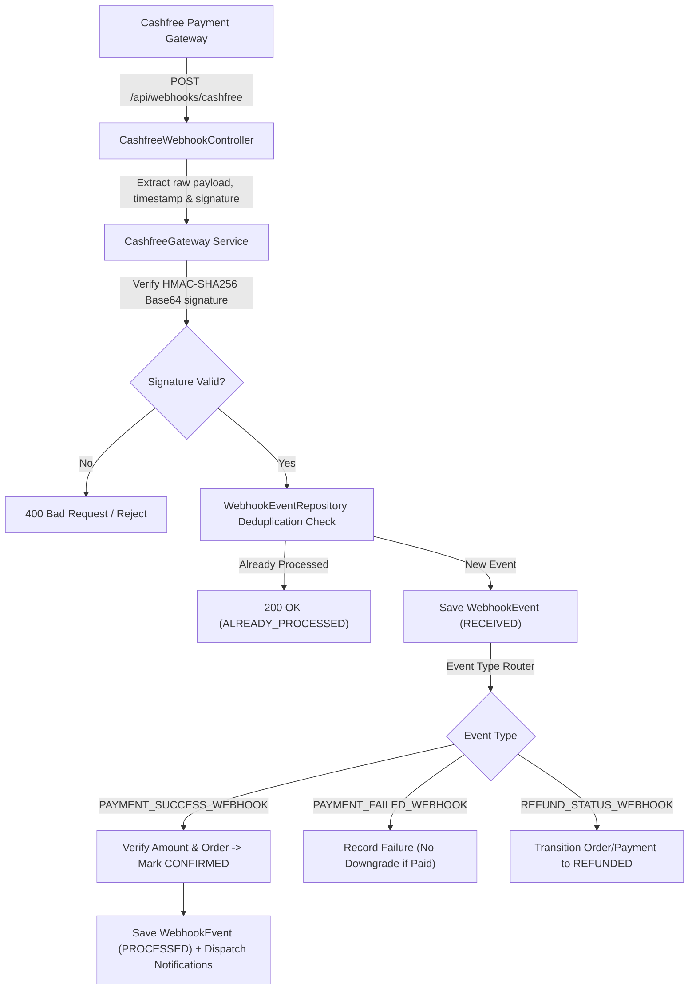

# OHO TECH — Cashfree Payment Webhook Integration Guide

## 1. Overview & Architecture

This document specifies the server-side integration of Cashfree Payment Gateway webhooks into the **OHO TECH** platform.

The webhook endpoint securely receives asynchronous event notifications from Cashfree, validates HMAC-SHA256 signatures, deduplicates incoming events, reconciles amounts, and updates internal PostgreSQL order and payment entities.

### Architecture Diagram



---

## 2. Webhook Endpoint Specifications

- **Route:** `POST /api/webhooks/cashfree`
- **Full Production URL:** `https://ohotechn.com/api/webhooks/cashfree`
- **Security Access:** Public / unauthenticated delivery permitted by Spring Security in [`SecurityConfig.java`](file:///c:/Users/himan/OneDrive/Desktop/oho_tech/backend/src/main/java/com/ohotech/backend/security/SecurityConfig.java) with mandatory cryptographic signature verification.
- **Request Headers Evaluated:**
  - `x-webhook-signature` (or `X-Webhook-Signature`): Base64-encoded HMAC-SHA256 signature
  - `x-webhook-timestamp` (or `X-Webhook-Timestamp`): Timestamp string sent by Cashfree
  - `Content-Type`: `application/json`

---

## 3. Cryptographic Signature Verification Algorithm

As specified by Cashfree:
1. Capture the exact, unmodified raw HTTP body as `rawPayload`.
2. Extract the `timestamp` header from `x-webhook-timestamp`.
3. Concatenate: `dataToSign = timestamp + rawPayload`.
4. Generate the HMAC-SHA256 hash using the secret key (`CASHFREE_WEBHOOK_SECRET` with fallback to `CASHFREE_CLIENT_SECRET`).
5. Base64 encode the binary digest.
6. Perform constant-time byte comparison (`MessageDigest.isEqual`) against `x-webhook-signature`.

---

## 4. Environment Variables & Configuration

Configure these environment variables in your server configuration or Docker/Kubernetes secrets:

| Variable | Type | Description | Sandbox Example | Production Example |
| :--- | :--- | :--- | :--- | :--- |
| `CASHFREE_CLIENT_ID` | String | Cashfree App ID / Client ID | `TEST10...` | `10...` |
| `CASHFREE_CLIENT_SECRET` | String | Cashfree Client Secret Key | `cfsk_ma_test_...` | `cfsk_ma_prod_...` |
| `CASHFREE_WEBHOOK_SECRET`| String | Webhook Secret Key from Merchant Dashboard | `cf_sec_test_...` | `cf_sec_prod_...` |
| `CASHFREE_ENVIRONMENT` | String | Gateway environment mode (`SANDBOX` or `PRODUCTION`) | `SANDBOX` | `PRODUCTION` |
| `CASHFREE_API_VERSION` | String | Cashfree PG API Version | `2025-01-01` | `2025-01-01` |
| `PAYMENT_CASHFREE_ENABLED` | Boolean | Operational feature flag | `true` | `true` |

> [!CAUTION]
> Never commit real secrets to Git or expose Cashfree secrets in client-side Next.js environment files (`NEXT_PUBLIC_*`).

---

## 5. Cashfree Merchant Dashboard Configuration Steps

To link your Cashfree dashboard to the production endpoint:

1. Log in to the [Cashfree Merchant Dashboard](https://merchant.cashfree.com/merchants/login).
2. Navigate to: **Developers** → **Webhooks** → **Payment Gateway**.
3. Click **Add Webhook** / **Configure Webhook**.
4. Set **Webhook URL**:
   ```
   https://ohotechn.com/api/webhooks/cashfree
   ```
5. Select the Events to subscribe:
   - `PAYMENT_SUCCESS_WEBHOOK`
   - `PAYMENT_FAILED_WEBHOOK`
   - `PAYMENT_USER_DROPPED_WEBHOOK`
   - `REFUND_STATUS_WEBHOOK`
6. Copy the generated **Webhook Secret Key** and configure it as `CASHFREE_WEBHOOK_SECRET` on the server.
7. Test using Cashfree's **Send Test Event** feature and verify that the endpoint returns `200 OK`.

---

## 6. Idempotency & Order Lifecycle Guardrails

1. **Deduplication:** Every incoming event calculates a unique event identifier (`cf_pay_{id}_{eventType}`). If already recorded in the `crm_webhook_events` table, the server immediately returns `200 OK` with status `"ALREADY_PROCESSED"`.
2. **Order Reconciliation:** The order amount and currency reported by Cashfree are strictly compared against the internal order total. Discrepancies abort processing with `400 Bad Request`.
3. **No Down-grade Rule:** Delayed `PAYMENT_FAILED_WEBHOOK` or dropped events will **never** downgrade an order that has already transitioned to `CONFIRMED` or `PAID`.
4. **Phase 10 Admin Approval Compliance:** Verified successful payments transition orders to `CONFIRMED`. License keys and software download privileges are activated upon explicit administrator approval or through the admin verification flow.
5. **Database Transaction Boundaries:** Processing runs inside `@Transactional` database methods, ensuring atomicity across payments, orders, and event tables. Slow external HTTP calls for health checks are decoupled from webhook processing transactions.
